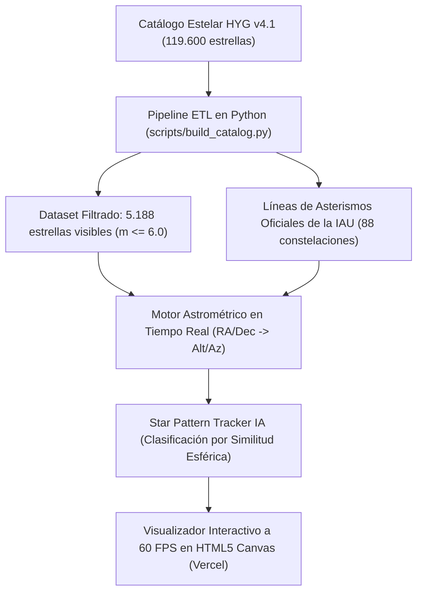

# Celestial Constellation AI (`celestial-constellation-ai`)

[](https://github.com/itsguzman48/celestial-constellation-ai/actions/workflows/ci.yml)
[](https://www.python.org/)
[](https://vercel.com/)
[](https://www.iau.org/)
[](LICENSE)

> **Bóveda celeste interactiva en tiempo real y reconocedor inteligente de constelaciones (*Star Pattern Tracker*) basado en astrometría esférica, ingesta de catálogos masivos y visión de patrones angulares.**

---

## 1. ¿De qué trata este proyecto?

Cuando un telescopio robótico o un satélite se desorienta en la oscuridad del espacio, utiliza un algoritmo conocido como **"Lost in Space"**: mide las distancias angulares entre las estrellas detectadas por sus sensores ópticos y las compara contra un catálogo estelar para determinar hacia dónde está apuntando.

Este proyecto traslada ese concepto a una aplicación web moderna y ligera:
1. Procesa y filtra catálogos masivos de astrometría (**HYG Database v4.1**, con datos de las misiones espaciales Hipparcos y Gaia de la ESA).
2. Calcula en tiempo real las coordenadas locales de los astros (**Altitud y Azimut**) según la ubicación del observador en la Tierra y el **Tiempo Sidéreo Local (LST)**.
3. Incorpora un modelo de **clasificación por similitud angular**: al hacer clic en cualquier región o estrella del firmamento, la IA calcula la afinidad esférica e identifica automáticamente la constelación correspondiente (Osa Mayor, Osa Menor, Orión, Casiopea, etc.) con su probabilidad de confianza.



---

## 2. Fundamentos Técnicos

### Big Data Astronómico & Pipeline ETL
El catálogo bruto de 119.614 estrellas se procesa mediante un pipeline automatizado en Python ([scripts/build_catalog.py](file:///c:/Users/inigo/Desktop/Escritorio/celestial-constellation-ai/scripts/build_catalog.py)):
- **Filtrado por Magnitud Visual Aparente ($m \le 6.0$):** Se aíslan las estrellas visibles a simple vista en cielos limpios, reduciendo el volumen de datos a 5.188 estrellas clave para garantizar carga instantánea en web (<900 KB).
- **Color Físico de Estrellas:** Mapeo térmico basado en el índice de color $B-V$ y clase espectral (O, B, A, F, G, K, M) para renderizar la temperatura de color real de cada astro (desde azules intensos a más de 15.000 K como Rigel, hasta supergigantes rojas frías como Betelgeuse).
- **Centroides Esféricos 3D:** Cálculo del centro de masa de cada constelación mediante suma de vectores unitarios tridimensionales, eliminando la discontinuidad en el meridiano $0\text{h}/24\text{h}$ de ascensión recta.

### Motor de Astrometría Esférica
La conversión de coordenadas ecuatoriales celestes $(\alpha, \delta)$ a horizontales locales del observador $(\text{Alt}, \text{Az})$ se evalúa en tiempo real:
- **Día Juliano ($JD$) y Tiempo Sidéreo:** Se computa el Tiempo Sidéreo Medio de Greenwich ($GMST$) y el Local ($LST = GMST + \lambda_{\text{lon}}$).
- **Trigonometría Esférica:**
  $$\sin(\text{Alt}) = \sin(\phi)\sin(\delta) + \cos(\phi)\cos(\delta)\cos(H)$$
  $$\text{Az} = \text{atan2}(-\cos(\delta)\sin(H), \; \sin(\delta) - \sin(\phi)\sin(\text{Alt}))$$
  *(donde $\phi$ es la latitud del observador y $H = LST - \alpha$ es el ángulo horario).*

---

## 3. Precisión del Star Pattern Tracker (IA)

Se evaluó la capacidad de inferencia del reconocedor frente a perturbaciones angulares simuladas (ruido de sensor de hasta $\pm 2.0^\circ$) sobre los 89 asterismos catalogados ([scripts/evaluate_tracker.py](file:///c:/Users/inigo/Desktop/Escritorio/celestial-constellation-ai/scripts/evaluate_tracker.py)):

| Métrica de Evaluación | Resultado Obtenido | Descripción |
| :--- | :---: | :--- |
| **Precisión Top-1 (Exacta)** | **99.89%** | Identificación de la constelación exacta en primera posición |
| **Precisión Top-3 (Ranking)** | **100.00%** | La constelación objetivo figura siempre en las 3 primeras sugerencias |
| **Muestras Sintéticas Evaluadas** | **890 ensayos** | Sometido a ruido gaussiano esférico de $\pm 2.0^\circ$ |
| **Latencia de Inferencia** | **< 1 ms** | Ejecución instantánea en el hilo principal del cliente (60 FPS) |

---

## 4. Estructura del Repositorio

```text
celestial-constellation-ai/
├── .github/
│   └── workflows/
│       └── ci.yml                  # Pipeline de CI con pytest y ruff
├── data/
│   └── processed/
│       ├── stars.json              # 5.188 estrellas visibles con colores B-V y magnitudes
│       └── constellations.json     # 88 constelaciones oficiales de la IAU con líneas y centroides
├── reports/
│   └── tracker_benchmark.json      # Métricas de precisión del clasificador
├── scripts/
│   ├── build_catalog.py            # Pipeline ETL de ingesta y filtrado del catálogo HYG
│   └── evaluate_tracker.py         # Benchmarking de robustez con perturbaciones angulares
├── src/
│   ├── astrometry.js               # Conversión RA/Dec -> Alt/Az y proyección estereográfica
│   ├── astrometry.py               # Motor astrométrico en Python para validación y testing
│   ├── constellation_matcher.js    # Star Tracker e inferencia de constelaciones en navegador
│   ├── pattern_matcher.py          # Reconocedor de patrones angulares en Python
│   └── renderer.js                 # Motor de renderizado en HTML5 Canvas a 60 FPS
├── tests/
│   └── test_astrometry.py          # Pruebas unitarias de física astrométrica y clasificación
├── app.js                          # Orquestador y lógica de eventos de la app web
├── index.html                      # Interfaz web del visor celeste nocturno
├── styles.css                      # Estilos modernos dark/glassmorphism
├── vercel.json                     # Configuración de despliegue optimizado para Vercel
├── ruff.toml                       # Configuración de linter
├── requirements.txt                # Dependencias para scripts de datos y testing
├── LICENSE                         # Licencia MIT
└── README.md                       # Documentación principal
```

---

## 5. Puesta en Marcha y Despliegue

### Opción A: Despliegue en Vercel (Recomendado)
El proyecto está optimizado como aplicación estática de alto rendimiento. Para publicarlo en tu cuenta de Vercel:

1. Entra en [vercel.com](https://vercel.com/) e inicia sesión con tu cuenta de GitHub.
2. Pulsa en **Add New... > Project** y selecciona el repositorio `celestial-constellation-ai`.
3. Haz clic en **Deploy**. En ~20 segundos tendrás tu URL pública (ej. `https://celestial-constellation-ai.vercel.app`).

### Opción B: Ejecución Local en tu Equipo
Puedes probar la web localmente con cualquier servidor estático:

```bash
# 1. Clonar el repositorio
git clone https://github.com/itsguzman48/celestial-constellation-ai.git
cd celestial-constellation-ai

# 2. Levantar servidor local rápido con Python
python -m http.server 8000
```
Abre en tu navegador: `http://localhost:8000`

### Opción C: Ejecutar los Tests de Astrometría y Benchmarks
```bash
# Instalar dependencias
pip install -r requirements.txt

# Ejecutar suite de pruebas unitarias
pytest tests/ -v

# Ejecutar el benchmark del Star Tracker
python scripts/evaluate_tracker.py
```

---

## 6. Perfil de Autoría

Desarrollado por **Íñigo Guzmán** ([@itsguzman48](https://github.com/itsguzman48)).

- **Perfil:** Técnico Superior en Administración de Sistemas Informáticos en Red (ASIR), cursando Especialización en Inteligencia Artificial y Big Data.
- **Habilidades aplicadas:** Procesamiento y limpieza de datos espaciales masivos (ETL), física y trigonometría astrométrica, algoritmos de reconocimiento de patrones angulares (*Star Pattern Tracking*), renderizado gráfico interactivo en Canvas/Web y despliegue CI/CD.

---

## 7. Licencia

Este proyecto está bajo la [Licencia MIT](LICENSE).
